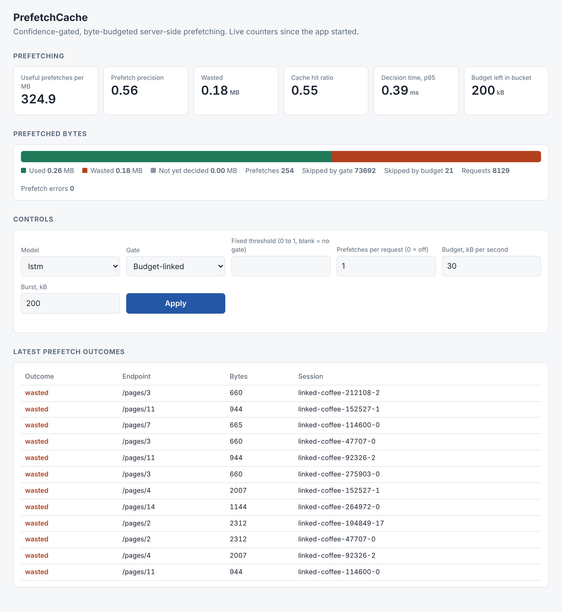

# PrefetchCache

Confidence-gated, byte-budgeted server-side prefetching middleware for web
application caches, with a precision-per-byte evaluation method.

Final year project, 6SENG010C. Kaveesh (IIT 20223173 | UoW W1986691).
Supervisor: Ms Sapna Kumarapathirage.

## Status

| Milestone | Work package | Contents | State |
|---|---|---|---|
| M1 | WP2 | Data loaders, user-level split, baselines, replay simulator, precision-per-byte metrics, budget sweep | Done |
| M2 | WP2 | Real coffee-shop and Retailrocket data: loader checks, data profile, frozen test split, baselines on validation data | Done |
| M3 | WP3 | LSTM and small Transformer in PyTorch, temperature scaling, ONNX export, latency benchmark (NFR1) | Built; first single-seed runs on real data; tuning and five-seed runs outstanding |
| M4 | WP4 | Budget-linked gate; FastAPI middleware with per-session Redis keys, token bucket, used/wasted prefetch log and admin API; requirement tests for FR2 to FR5, NFR2, NFR3 | Done; not yet run against a real Redis server or under load |
| M5 | WP5 | Demo shop API behind the middleware, live dashboard with runtime controls, HTTP session replay, Docker Compose with Redis | Running; Locust load test (O4) and simulator runs with the demo's response sizes outstanding |
| M6 | WP6 | RQ1 to RQ3 experiments on the frozen test split, five seeds, 95% confidence intervals | |

## Layout

```
src/prefetchcache/
  data/          sessions.py   RawSession, Session, Vocab (fitted on training data only)
                 coffee.py     coffee-shop clickstreams: token decoding, visit splitting
                 retailrocket.py  events.csv loader, 30-minute session gap
                 synthetic.py  Markov-chain generator for tests
                 split.py      70/15/15 split by user, frozen manifest with checksum
                 sizes.py      response sizes per endpoint
  predictors/    base.py       predictor interface (history in, ranked probabilities out)
                 baselines.py  popularity, first-order Markov
  policy/        gate.py       confidence threshold and top-k
                 budget.py     token-bucket byte budget
                 linked.py     budget-linked gate: confidence per byte against a price set by bucket fill
                 onnx_predictor.py  serves an exported model through ONNX Runtime
  models/        nets.py       LSTM and causal Transformer, same inputs for both
                 windows.py    left-padded training windows (last 20 requests)
                 calibration.py  temperature scaling, expected calibration error
                 train.py      training, calibration on validation data, ONNX export
  sim/           cache.py      per-session keys, TTL, LRU byte capacity
                 replay.py     request flow of deck slide 8
                 metrics.py    useful prefetches per MB, wasted bytes, precision, hit ratio
                 sweep.py      replay at five byte budgets
  middleware/    store.py      per-session cache keys; memory and Redis stores
                 engine.py     serve first, then predict, gate, budget, prefetch, log used/wasted
                 app.py        FastAPI middleware and admin API (/prefetchcache/stats, /config, /log)
  experiments/   run_sweep.py  budget sweep for baselines and exported models
                 latency.py    decision-latency benchmark against the 5 ms limit
                 compare.py    paired comparison of two policies across runs
  demo/          backend.py    coffee-shop API, one GET endpoint per app page
                 app.py        API + middleware + dashboard, configured by environment variables
                 dashboard.html  live counters and controls for model, gate and budget
                 replay.py     replays sessions over HTTP and reports response times
models/coffee/   exported LSTM and Transformer (seed 0, trained on all training users)
tests/           pytest suite; runs in GitHub Actions on every push
```

Planned: `loadtest/` (Locust).

## Demo application



```
docker compose up --build          # app on http://localhost:8000, with Redis
python -m prefetchcache.demo.replay --sessions 300      # send traffic; watch the dashboard
```

Without Docker: `pip install -e ".[serve]"`, then `uvicorn prefetchcache.demo.app:app --port 8000` (uses an in-process cache unless `REDIS_URL` is set).

- `GET /pages/{n}` is the shop API. Requests carry a session id in the `X-Session-Id` header; the response header `X-PrefetchCache` says `hit` or `miss`.
- `/dashboard` shows useful prefetches per MB, precision, wasted bytes, hit ratio, decision time and the budget, and changes model, gate, threshold and budget while the app runs.
- `/prefetchcache/stats`, `/config`, `/log`, `/reset` and `/sizes` are the admin API.

The dataset identifies pages only by number, so the demo returns generated catalogue JSON with a fixed size per page (142 bytes to 17.9 kB, median 1.3 kB; `results/coffee/demo_response_sizes.json`) and a simulated backend delay. A prefetch is only issued for an endpoint whose response size has already been observed, so it can be charged to the budget before it is fetched.

## Run

```
pip install -e ".[dev,train]"
pytest -q

# baselines only
python -m prefetchcache.experiments.run_sweep --dataset synthetic

# train, export, benchmark and sweep the two models (repeat for seeds 0 to 4)
python -m prefetchcache.models.train --dataset synthetic --model lstm --seed 0
python -m prefetchcache.models.train --dataset synthetic --model transformer --seed 0
python -m prefetchcache.experiments.latency artifacts/synthetic/lstm/seed0 artifacts/synthetic/transformer/seed0
python -m prefetchcache.experiments.run_sweep --dataset synthetic --models-dir artifacts

# real data (files under data/raw/, not in the repository)
python -m prefetchcache.experiments.run_sweep --dataset retailrocket --path data/raw/events.csv
python -m prefetchcache.experiments.run_sweep --dataset coffee --path data/raw/dataset_session-based_isoweekofday_hour --user-sample 0.1
```

Datasets are not stored in the repository. Place them under `data/raw/`.

## Datasets as found

**Coffee-shop clickstreams** (`dataset_session-based_isoweekofday_hour`, 782 MB, 296,100 lines, 43.4 million requests, 96,618 users, 46 pages).

- Each item is a 14-digit token: 7-digit user, 3-digit page, 2-digit ISO weekday, 2-digit hour. Every line belongs to one user.
- A line is not one visit. 52% of lines contain a jump of five hours or more between consecutive requests, and 26% go backwards in weekday/hour order. The longest line has 550,833 requests.
- 34% of consecutive requests repeat the same page; page 1 accounts for most of these.
- Preparation used here: split a line into visits wherever consecutive requests are not in the same or the next hour; drop immediate repeats of a page; keep visits of 2 to 200 requests. Result: 909,182 visits, 18.1 million requests, 95,673 users, median visit length 13.

**Retailrocket** (`events.csv`, 2,756,101 events over 138 days).

- Sessions by a 30-minute inactivity gap, at least two events: 382,780 sessions, 315,640 visitors, 1.38 million events, median session length 2.
- 135,261 distinct items viewed; 49,238 have five or more views and cover 87% of views.

Splits are 70/15/15 by user. The seed, part sizes and a checksum of the assignment are frozen in `results/<dataset>/split_manifest.json`. No test-split result has been produced.

## First results on validation data

These are development runs on the validation split with placeholder response sizes. They are not the final experiments.

Coffee shop, 10% user sample, one model seed, ungated top-1, unlimited budget (100% level):

| Predictor | Next-page accuracy | Prefetch precision | Hit ratio | Decision p95 |
|---|---|---|---|---|
| No prefetching | | | 0.114 | |
| Popularity | | 0.70 | 0.21 | |
| First-order Markov | | 0.71 | 0.54 | |
| LSTM | 0.696 | 0.86 | 0.67 | 0.40 ms |
| Transformer | 0.697 | 0.86 | 0.65 | 0.51 ms |

Retailrocket, all users, one model seed (models stopped at 6 epochs while still improving), top-1:

| Predictor | Policy | Prefetch precision | Useful per MB | Wasted MB | Hit ratio |
|---|---|---|---|---|---|
| No prefetching | | | | | 0.170 |
| First-order Markov | ungated, 100% budget | 0.040 | 4.6 | 661 | 0.190 |
| LSTM | ungated, 100% budget | 0.024 | 2.4 | 834 | 0.183 |
| Transformer | ungated, 100% budget | 0.028 | 2.8 | 833 | 0.185 |
| First-order Markov | fixed gate 0.5 | 0.164 | 12.6 | 27 | 0.173 |
| LSTM | fixed gate 0.5 | 0.277 | 24.5 | 8 | 0.172 |
| Transformer | fixed gate 0.5 | 0.210 | 16.3 | 15 | 0.172 |
| LSTM | budget-linked, 5% budget | 0.051 | 7.9 | 49 | 0.173 |

Predicting the next item out of about 38,000 is rarely right, so ungated prefetching wastes almost everything and the neural models do not beat Markov. A fixed confidence gate removes over 95% of the waste. The budget-linked gate without a confidence floor does not help here (7.9 against 8.7 useful per MB for ungated at the 5% budget): when almost every candidate is unlikely, price per byte alone is not enough. Combining the linked gate with a confidence floor is the next thing to test. Decision time with this vocabulary was 3.3 ms (LSTM) and 2.6 ms (Transformer) at p95, measured on a busy machine.

Coffee shop, models trained on all users, five seeds, replayed on 20% of validation users (mean of five runs; each run also draws new placeholder response sizes):

| Model | Next-page accuracy | Training time | Decision p95 |
|---|---|---|---|
| LSTM | 0.6949 ± 0.0016 | 7.8 min | 0.13 ms |
| Transformer | 0.6970 ± 0.0016 | 46 min | 0.23 ms |

Useful prefetches per MB, LSTM, top-1:

| Budget | Ungated | Fixed gate 0.5 | Budget-linked | Wasted MB, ungated | Wasted MB, linked | Hit ratio, ungated | Hit ratio, linked |
|---|---|---|---|---|---|---|---|
| 100% | 81.6 | 81.7 | 81.6 | 435 | 435 | 0.684 | 0.684 |
| 50% | 115.0 | 111.9 | 121.9 | 215 | 202 | 0.536 | 0.557 |
| 25% | 152.1 | 148.8 | 165.7 | 117 | 103 | 0.396 | 0.418 |
| 10% | 217.8 | 212.7 | 232.0 | 53 | 45 | 0.279 | 0.288 |
| 5% | 287.9 | 278.0 | 280.5 | 27 | 23 | 0.223 | 0.221 |

The budget-linked gate admits a candidate only if its probability per byte is at least a price that rises while the token bucket is below half full and falls while it is above. It gains 6 to 9% over ungated prefetching at the 50, 25 and 10% budgets, matches it at 100%, and is 3% behind at the 5% budget. The fixed 0.5 gate is behind ungated at every budget below 100%. The Transformer follows the same pattern (`results/coffee/models_validation_all_users.csv`). Compared run by run (same model seed and response sizes in both arms, five runs, 95% confidence interval of the difference):

| Budget | LSTM: linked minus ungated, useful per MB | Transformer: linked minus ungated, useful per MB | LSTM: hit ratio difference |
|---|---|---|---|
| 100% | +0.02 ± 0.04 | +0.02 ± 0.05 | 0.000 |
| 50% | +6.9 ± 2.2 | +5.5 ± 1.6 | +0.021 ± 0.009 |
| 25% | +13.6 ± 4.6 | +11.9 ± 3.4 | +0.022 ± 0.011 |
| 10% | +14.2 ± 8.3 | +9.0 ± 3.2 | +0.009 ± 0.006 |
| 5% | −7.4 ± 28.7 | −15.5 ± 46.9 | −0.002 ± 0.011 |

The gain at the 50, 25 and 10% budgets is significant for both models and holds in all five runs. At 100% there is no difference, and at 5% the result is inconclusive: the linked gate was ahead in two of five LSTM runs and one of five Transformer runs. The fixed 0.5 gate is never significantly better than ungated prefetching. Full output: `results/coffee/paired_comparison_all_users.txt`.

Full tables are in `results/<dataset>/`.

## Metric definitions

- **Useful prefetch**: a prefetched response requested by the same session before its TTL expires. Counted once.
- **Wasted bytes**: bytes prefetched and not requested before expiry, session end or eviction.
- **Useful prefetches per MB**: useful prefetches divided by MB prefetched.
- **Precision**: useful prefetches divided by prefetches issued.
- **Hit ratio**: cacheable (GET) requests served from the cache, divided by cacheable requests.

Prefetched bytes always equal useful bytes plus wasted bytes; the test suite checks this.

## Decisions to confirm with the supervisor

These are not fixed in the proposal deck. The code uses the proposed value for each until confirmed.

| Item | Proposed | Where |
|---|---|---|
| Five budget levels | 100, 50, 25, 10 and 5% of the bytes spent by ungated top-k with the same model | `sim/sweep.py` |
| Token-bucket burst | 20 time units of refill, and at least the largest response | `sim/sweep.py` |
| Clock for the coffee-shop data (no timestamps) | One tick per request; TTL and refill are counted in requests | `sim/replay.py` |
| Cache expiry | 5 requests (coffee shop); 300 s (Retailrocket) | `run_sweep.py --ttl` |
| Coffee-shop visits | Split on a gap of more than one hour bucket; drop immediate page repeats; keep visits of 2 to 200 requests | `data/coffee.py` |
| Top-k | k = 1, with k = 3 as a sensitivity run | `run_sweep.py --top-k` |
| Retailrocket endpoints | view = `GET /items/{id}`, add to cart = `POST /cart`, transaction = `POST /orders`; items seen fewer than 5 times in training map to an unknown id and are never prefetched | `data/retailrocket.py` |
| Response sizes until the demo app exists | Seeded log-normal, median 8 kB | `data/sizes.py` |
| Model sizes | LSTM: 64-d embedding, one 128-unit layer. Transformer: 64-d, 2 layers, 4 heads, feed-forward 128. Window of the last 20 requests. To be tuned on validation data | `models/nets.py` |
| Success criteria | The gated policy gives more useful prefetches per MB than ungated top-k at every budget, with at most 10% relative loss in hit ratio; decision time at or below 5 ms p95 | to be fixed before testing |

## Known limitations so far

- The live app has only been exercised with short replays, not a controlled load test. A first replay showed the budget-linked gate over-tightening under concurrent traffic because its price moved once per decision; it now moves with elapsed time. After that change, two replays of 400 validation sessions at a 30 kB/s budget gave 599 and 547 useful prefetches per MB for the linked gate against 559 and 519 for ungated. Two repetitions are not a result; the Locust test (O4) has to confirm it.

- Coffee-shop models have five seeds on all users but untuned hyperparameters; Retailrocket models have one seed and were stopped early.
- Model seed and response-size draw change together in each run, so unpaired confidence intervals are wide; policies are compared pairwise per run instead.
- The budget-linked gate has no advantage at the tightest (5%) budget. Its step size and target fill are untuned, and a confidence floor has not been tested.
- Dropping repeated pages removes 56% of coffee-shop requests. Keeping them would make prediction easier and is a decision to confirm.
- Response sizes are a placeholder distribution until the demo app provides measured sizes.
- Markov probabilities on Retailrocket are overconfident (precision 0.27 at a 0.7 gate) because many transitions are seen only a few times.
- With a tight token bucket only small responses fit, which raises useful prefetches per MB for the ungated policy too. A fixed confidence threshold therefore gains little per MB over ungated prefetching at the same budget. The budget-linked gate is the response to this; its step size and target fill are not tuned yet.
